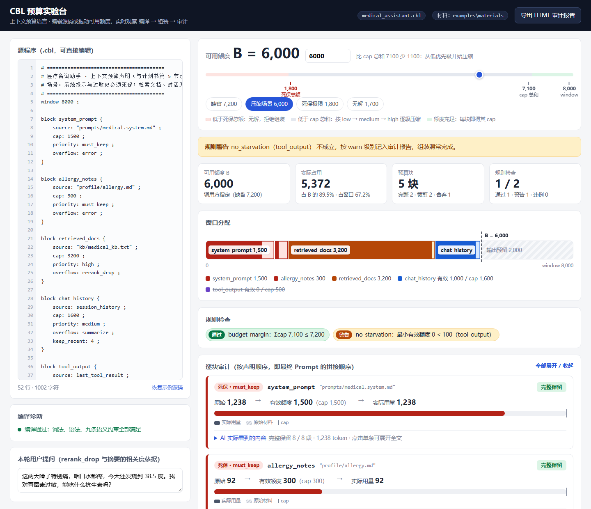

# CBL — 上下文预算语言（Context Budget Language）

> 编译原理 DSL 实验项目：用一门声明式小语言描述"AI 上下文窗口里，
> 各类信息各占多少额度、优先级如何、超额后如何处理"。

## 这是什么

大模型的上下文窗口是有限的token资源池。CBL 把"预算分配"从散落在代码里的
魔法数字，变成一份可以被编译器检查、被版本管理、被审计的 `.cbl` 声明文件：

```
源文件 → 词法分析 → 语法分析 → 语义检查 → JSON 组装计划 → 预算执行引擎 → 最终 Prompt + 审计报告
        （lexer）   （parser）  （semantic）   （ir）            （engine）       （report）
```

## 目录结构

```
cbl/
├── cbl/                 # 编译器包
│   ├── tokens.py        #   Token 类型 + 21 个关键字表
│   ├── lexer.py         #   词法分析器（逐字符有限自动机）      —— 徐同帅
│   ├── parser.py        #   语法分析器（手写递归下降）          —— 徐同帅
│   ├── ast_nodes.py     #   AST 节点定义
│   ├── semantic.py      #   语义检查器（九条约束，错误目录+表驱动）—— 舒若凡
│   ├── ir.py            #   AST → JSON 组装计划（中间表示）
│   ├── engine.py        #   预算执行引擎（优先级压缩 + 五种超限策略）—— 杨晨
│   ├── report.py        #   审计报告（JSON / 文本 / 独立 HTML）  —— 祝梦倩
│   ├── webui.py         #   网页演示：预算实验台（零依赖 HTTP 服务）
│   ├── static/          #   页面与 HTML 报告共用的渲染器（report.js / report.css / demo.html）
│   └── cli.py           #   命令行入口（check / run / serve）
├── examples/
│   ├── medical_assistant.cbl   # 医疗助手完整示例
│   └── materials/              # 示例上下文材料（见其中 README）
├── tests/
│   ├── run_tests.py            # 自检脚本（统一入口）
│   ├── engine_cases.py         # 引擎与报告用例
│   ├── webui_cases.py          # 网页演示、HTML 报告、HTTP 接口用例
│   └── snapshots/              # 审计报告快照
├── docs/demo.png               # 预算实验台截图
├── 启动预算实验台.bat          # Windows 双击启动
└── 手机访问预算实验台.bat      # 局域网模式（手机同一 Wi-Fi 访问）
```

## 怎么跑

环境：Python 3.7+，纯标准库，零第三方依赖。

```bash
cd cbl
python -m cbl check examples/medical_assistant.cbl   # 编译检查，输出 JSON 计划
python -m cbl run   examples/medical_assistant.cbl   # 编译 + 组装，打印审计报告
python -m cbl run   examples/medical_assistant.cbl --budget 6000 --out prompt.txt --json audit.json --html audit.html
python -m cbl serve                                  # 网页演示：预算实验台（见下节）
python tests/run_tests.py                            # 跑自检（52 个用例）
```

`run` 的输出示例（缺省可用额度 7200）：

```
=== CBL 组装审计报告 ===  window=8000  可用=7200  占用=6542 (81.8%)
[must_keep] system_prompt   cap=1500 used=1238 完整保留
[must_keep] allergy_notes   cap=300  used=92   完整保留
[high]      retrieved_docs  cap=3200 used=3145 原始 4774
            -> rerank_drop 丢弃相关度最低的 9 段
[medium]    chat_history    cap=1600 used=1590 原始 2270
            -> summarize 保留最近 4 轮原文，早期 4 轮压缩为摘要（404 token）
[low]       tool_output     cap=500  used=477  原始 658
            -> truncate_tail 截断尾部 181 token
规则检查：budget_margin  通过 (7100 <= 7200)
          no_starvation  通过 (最小有效额度 300 >= 100)
```

`--budget 6000` 时 low 级的 tool_output 被压缩到 0 整块舍弃、medium 级的 chat_history
压缩到 1000，动态断言 no_starvation 报警告——与计划书第 5 节的压缩示例一致。

## 预算实验台（网页演示）

```bash
python -m cbl serve            # 浏览器自动打开 http://127.0.0.1:8000；Windows 也可双击 启动预算实验台.bat
python -m cbl serve --lan      # 局域网模式：手机连同一 Wi-Fi 即可访问
```



- **拖动可用额度 B**：窗口条实时显示各块的有效额度与实际用量；滑块上标出死保总额（低于即无解）、
  cap 总和（低于即开始压缩）、缺省 B 三个临界点，预设按钮一键切换场景
- **直接编辑 .cbl 源码**：词法/语法/语义诊断带行号与错误编号实时显示，点击跳到对应行
- **AI 实际看到了什么**：每块展开后逐段/逐轮标注 保留 / 部分保留 / 并入摘要 / 丢弃
- **导出独立 HTML 审计报告**：与页面共用同一渲染器，单文件离线可看、可打印存档
- 地址参数 `?budget=6000` 直接打开某个场景，便于答辩时切换与截图
- 安全：字符串来源被限制在材料目录内（防止通过编辑源码读取任意文件）；请求体限 256KB

## 当前进度

- [x] 词法分析器、语法分析器（第一版，可用）
- [x] 语义检查 ①~⑨ 全部完成（错误目录 `semantic.CATALOG` 共 16 项，每项配正例/反例测试）
- [x] 静态断言（total_reserved）编译期求值；动态断言（every_block_min_tokens）留给引擎
- [x] 预算执行引擎：可用额度与优先级压缩（low → medium → high）、五种超限策略、运行期断言
- [x] 审计报告：JSON 主格式 + 文本视图；快照测试防止裁剪行为被悄悄改变
- [x] 审计报告 HTML 视图（独立单文件，与网页共用渲染器）
- [x] 加分项：网页演示「预算实验台」

语言的完整定义（EBNF 文法、九条语义约束、运行期语义）与分工详情见课程开发计划书（未随仓库公开）。

**组员审阅**：见 [docs/审阅指南.md](docs/审阅指南.md)——每人负责模块的阅读顺序、设计理由、动手实验与答辩问答。
